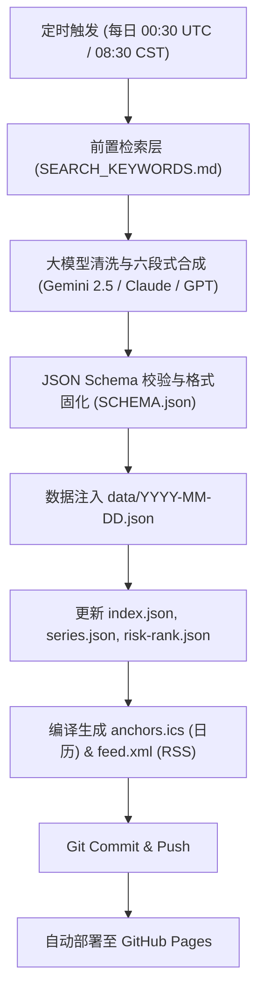

# AIDC 智算基础设施与硬件供应链情报中心
### AIDC Physical Infrastructure & Hardware Supply Chain Intelligence Hub

> 专注于全球 **AI 数据中心（AIDC）物理基建、高密算力机柜、供电配电、高速光铜互连与智算液冷** 的每日供应链情报系统。  
> 每天 **08:30 (CST)** 准时发布，穿透整机柜表象，追踪底层 Tier-2/Tier-3 木桶短板物料、齐套交付率与长周期（Long Lead Time）锁单动态。

[](https://github.com/Silent-Master/HVAC/actions/workflows/daily-intel.yml)
[](feed.xml)
[](anchors.ics)
[](LICENSE)

---

## 📖 核心定位与背景

在 AI 智算中心（AIDC）建设中，交付遵循严格的**木桶短板定律（Kitting Rate）**：一颗 EML 激光器芯片、一卷 Low-Dk 石英玻纤布、一台大容量主变压器或一个 UQD 盲插快接头的断供，就会直接卡死整座万卡集群（如 NVL72 机架）的通电与点亮。

本项目继承并演进自暖通供应链分析范式，将分析视角全面升级至 **AIDC 四大物理硬件底座**：
1. **供电、配电与备用电源**：主网升压变压器（交期 120+ 周）、大功率柴发机组、54V 钛金级服务器电源 (PSU)、高压直流 (HVDC)、机柜级 BBU。
2. **光互连与高速铜连接**：800G/1.6T 光模块、EML/CW 光芯片、硅光 (SiPh)、224G/112G 发泡绝缘芯线 (AEC/DAC 直连铜缆)、MPO 连接器。
3. **算力机柜、高频材料与整机 ODM**：高密算力机柜组装 (NVL72/NVL36)、HLC 高多层板 (32~44层)、M8 级高频高速覆铜板 (CCL)、极低介电常数 (Low-Dk) 石英玻纤布。
4. **智算液冷与热管理系统**：In-Row / Floor 级液冷分配单元 (CDU)、GPU 微通道冷板、UQD 盲插快速接头、不锈钢分水歧管 (Manifold)、不锈钢钎焊板式换热器 (BPHE)。

---

## 🏛️ 早报架构：六段式分析 + 两大决策看板

早报坚持高密度、强因果推导，严禁空洞新闻堆砌，固定分为 8 大模块：

| 模块 | 模块名称 | 核心关注要点与供应链逻辑 |
| :--- | :--- | :--- |
| **`#s1`** | **算力基建与 CapEx 动态** | 北美四大 CSP 与主权 AI 资本开支指引、机房拿地与电网并网排队（Interconnection Queue）、绿电与核电 PPA。 |
| **`#s2`** | **核心头条事件深度拆解** | 当日对 AIDC 冲击最大的 1~3 个重磅事件：【事件还原】+【BOM 冲击路径】+【短期/中期交付推演】。 |
| **`#s3`** | **大厂锁单与卡脖子木桶短板** | 算力巨头 LTA 锁单与产能配额虹吸、发泡芯线良率、Low-Dk 石英布现货溢价、重型变压器 120 周交期。 |
| **`#s4`** | **跨行业传导效应** | 欧美老旧电网改造抢装、重型燃气轮机排期、大宗商品（LME 铜、导电银浆）、PFAS 环保法案对特种冷却液/密封件冲击。 |
| **`#s5`** | **四大硬件底座供应商动态** | 按四大底座归类追踪核心厂商，打上标签 `[扩产/投产]`、`[良率/交期]`、`[财报/指引]`、`[新品/进AVL]`、`[并购/合作]`。 |
| **`#s6`** | **齐套预警与寻源建议** | 按 🔴 高危断供 / 🟡 交期拉长 / 🟢 议价窗口 分类，给出采购锁单周期（周数）、二供承认及安全库存操作指南。 |
| **`#s7`** | **事件时间线与时间锚点** | 抽取未来确定性节点（CSP 财报日、芯片流片/量产节点、OCP/GTC 行业峰会、新厂爬坡），生成 `.ics` 提前 1 天日历提醒。 |
| **`#s8`** | **AIDC 黄金 BOM 供需看板** | 映射 9 大核心硬件节点的供需紧平衡状态（`极度紧缺` / `紧平衡` / `供给宽松`）及标准交期（Lead Time 周数趋势）。 |

---

## ⚖️ 铁律与红线规则（Prompt Constraints）

1. **严禁证券买卖建议**：剔除一切二级市场股价涨跌点评、市盈率/估值炒作，聚焦物理供应链核心事实（产能、订单、排产、交期、BOM 成本、二供导入与断供风险）。
2. **强制标注【厂商口径】**：凡属于企业 PR 通稿、展会宣传、发布会演讲口径自称的良率、产能、订单金额，必须显式标注 `【厂商口径】`；第三方研报与审计财报标注具体出处名称。
3. **事实核实与量化去水化**：拒绝空洞的行业套话，每条情报必须包含具体企业名称、零部件品类、地理区域、量化数字（产能规模、涨价幅度、交期周数）及信源出处。

---

## 📂 项目结构

```text
├── .github/
│   └── workflows/
│       └── daily-intel.yml     # GitHub Actions 自动化流水线（每日 08:30 定时触发并部署 Pages）
├── data/
│   ├── index.json              # 历史归档日期索引与最新发布日期
│   ├── series.json             # 核心物料交期与大宗价格走势时序数据（Sparklines）
│   ├── risk-rank.json          # 底层物料风险评分榜单（Risk Rank Matrix）
│   ├── taxonomy.json           # AIDC 物理硬件底座与 BOM 分级分类体系
│   ├── 2026-10-27.json         # 当日中文结构化情报数据
│   └── 2026-10-27-en.json      # 当日英文结构化情报数据
├── prompts/
│   ├── AIDC_SYSTEM_PROMPT.md   # 15 年经验 AIDC 首席情报官系统提示词
│   ├── SEARCH_KEYWORDS.md      # 5 组前置自动化爬虫/API 检索词矩阵
│   └── SCHEMA.json             # 约束大模型结构化输出的 JSON Schema
├── scripts/
│   ├── generate_daily.py       # 每日情报主生成流水线（支持 Gemini API 与离线模式）
│   ├── update_feeds.py         # 自动生成 anchors.ics、feed.xml、sitemap.xml
│   └── backfill.py             # 历史测试数据填充工具
├── index.html                  # 响应式 SPA 前端门户（支持暗黑数据中心风、侧栏导航、中英切换）
├── feed.xml                    # 自动生成的 RSS 2.0 订阅流
├── anchors.ics                 # 自动生成的 iCalendar 时间锚点订阅源
├── sitemap.xml                 # 搜索引擎 Sitemap
├── LICENSE                     # MIT 开源许可证
└── README.md                   # 项目工程与使用说明
```

---

## 🚀 自动化运行机制



---

## 💻 本地运行与开发

### 1. 克隆与准备环境
```bash
git clone https://github.com/Silent-Master/HVAC.git aidc-intel
cd aidc-intel
```

### 2. 本地直接预览网页
`index.html` 为纯静态现代前端，无需任何 Node 构建工具：
```bash
# Python 启动本地 HTTP 调试服务器
python -m http.server 8000
# 访问 http://localhost:8000 即可查看门户
```

### 3. 生成新一期早报数据
```bash
# 离线模式（内置高质量行业信号合成）
python scripts/generate_daily.py --date 2026-10-28 --provider offline

# 线上大模型模式（配置 GEMINI_API_KEY）
export GEMINI_API_KEY="your-api-key"
python scripts/generate_daily.py --date 2026-10-28 --provider gemini
```

### 4. 重新编译 RSS 与日历订阅文件
```bash
python scripts/update_feeds.py
```

---

## 🌐 部署至 GitHub Pages

1. 将仓库推送到 GitHub：
   ```bash
   git add .
   git commit -m "feat: initialize AIDC supply chain intelligence hub"
   git remote add origin https://github.com/<your-username>/aidc-intel.git
   git push -u origin main
   ```
2. 进入 GitHub 仓库设置：
   - 点击 **Settings** → **Pages**。
   - **Build and deployment** → **Source** 选择 **GitHub Actions**。
3. （可选）配置 API 密钥：
   - 点击 **Settings** → **Secrets and variables** → **Actions**。
   - 添加 `GEMINI_API_KEY`（或 `OPENAI_API_KEY`），GitHub Actions 每天早上将自动调用大模型生成最新情报。若不配置密钥，流水线将自动运行高精度确定性离线合成，确保 100% 稳定运行。

---

## 📅 订阅方式

- **时间锚点日历**：直接订阅 `webcal://<username>.github.io/<repo>/anchors.ics`，iPhone / Mac / Outlook 日历自动同步，提前 1 天 09:00 提醒。
- **RSS 聚合阅读**：在各大 RSS 阅读器（如 NetNewsWire, Feedly, Inoreader）中添加 `feed.xml`。

---

## 📄 License
本项目基于 [MIT 许可证](LICENSE) 开源。
